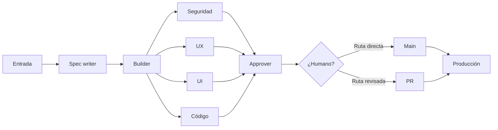

# Flujo en paralelo: la factory de Eric Risco, asimilada a este repositorio

Esquema tomado de la parte 6 («En paralelo») de la presentación del vídeo [«Programar con agentes ya no basta: monta tu Software Factory»](https://youtu.be/p6nnqerea7w), de Eric Risco. Su idea central: **una sola línea de fábrica** donde la construcción la hace un puesto y la revisión la hacen **cuatro revisores en paralelo**, cada uno con una sola lente, antes de que nada llegue a producción.

## La línea

1. **Entrada** — la materia prima: una tarea, un ticket, una petición con su contexto.
2. **Spec writer** — convierte la entrada en una especificación ejecutable: qué hay que construir, con qué criterios se acepta y cómo se demuestra que está bien. Sin spec no se construye.
3. **Builder** — construye exactamente lo que dice la spec. Un solo puesto, una sola responsabilidad.
4. **Revisión en paralelo** — cuatro revisores independientes miran la misma construcción a la vez, cada uno con su lente y sin mezclarse:
   - **Seguridad**: credenciales, permisos, superficies expuestas, datos sensibles.
   - **UX**: si el flujo se entiende y sirve a quien lo va a usar.
   - **UI**: coherencia visual, estados, detalles de presentación.
   - **Código**: corrección, simplicidad, pruebas, deuda que introduce.
   
   Si un revisor encuentra un fallo, el trabajo **vuelve al builder** con el fallo señalado; el revisor no arregla por su cuenta.
5. **Approver** — junta los cuatro veredictos. Solo pasa lo que los cuatro aprueban; cualquier rechazo devuelve la pieza a la línea.
6. **¿Humano? — la puerta de riesgo** — con todo aprobado, se decide la ruta según el riesgo de la pieza:
   - **Ruta `main`**: cambios de bajo riesgo, reversibles, dentro de lo ya pautado → integración directa.
   - **Ruta PR**: todo lo demás (producción, dinero, publicaciones, cambios delicados) → pull request y revisión humana antes de integrar.
7. **Producción** — la pieza integrada por cualquiera de las dos rutas. Lo que sale fuera siempre ha pasado por la puerta.

### Los modelos por puesto, según la presentación

La factory del vídeo no usa el mismo modelo para todo: reparte los puestos entre motores distintos, y ese reparto es parte del diseño.

- **Builder: Opus 5.5** — el modelo más fuerte construye; es el puesto donde un error sale más caro.
- **Seguridad, UX y UI: ChatGPT Sol y Astra** — las lentes de seguridad y de experiencia las miran motores *distintos* al que construyó: la crítica entre motores atrapa lo que un solo motor se deja pasar a sí mismo.
- **Código: Sonnet 5.5** — un nivel por debajo del builder; la revisión de código es la lente más mecánica de las cuatro y no necesita el modelo mayor.

La lección transferible no son los nombres, que cambiarán con cada generación de modelos: es el principio. **El que construye es el más capaz; los que revisan son de otra casa; y cada lente paga solo el modelo que su trabajo exige.**

## Cómo encaja con el kit de este repositorio

| Pieza del esquema | En el kit (AlpacaTech) |
|---|---|
| El criterio de los revisores | `cerebro/que-es-bien.md`: los revisores juzgan contra esa definición y sus ejemplos |
| Lo que la línea sabe antes de empezar | `cerebro/contexto.md` y `cerebro/lecciones.md` |
| Spec writer y builder | Los pasos de agente de `pasos/`, cada uno con su rol, su entrada y su salida |
| Revisores en paralelo | El loop de comprobaciones: quien produce no se revisa a sí mismo |
| Puerta «¿Humano?» | La regla del kit: nada que salga fuera se mueve sin el OK de la persona |
| Saber qué pieza falla más | La telemetría `herramientas/obs.py` y su `resumen` por ejecución |

## Qué aporta este esquema al kit

- **Paralelismo con lentes separadas**: revisar seguridad, UX, UI y código a la vez, con revisores distintos, detecta antes lo que una sola revisión general deja pasar.
- **La puerta como decisión de riesgo, no como costumbre**: no todo pasa por PR ni todo va directo a `main`; la ruta se elige por el riesgo de la pieza, y queda registrada.
- **La spec como contrato**: el builder no interpreta la petición; ejecuta una especificación que ya trae sus criterios de aceptación.

*Esquema asimilado el 5 de noviembre de 2026 a partir de la captura y el análisis del vídeo de Eric Risco, como complemento del kit de AlpacaTech que estructura este repositorio.*
